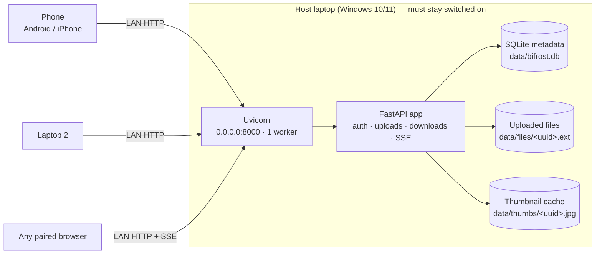

# Bifrost - The bridge between worlds. Your data, beyond distance.

**Self-hosted file and text sharing across the devices on your local network.**

Bifrost turns one computer into a private shared inbox. Any paired browser on the same
Wi-Fi or LAN can drop files or text notes into it, and every other paired device sees
them appear instantly. Nothing leaves your network: no cloud account, no subscription,
no external database, no third-party API. Once the dependencies are installed, the core
application works completely offline.

```
Host laptop  ──►  Bifrost server  ──►  every paired phone / laptop / browser
```

---

## Table of contents

- [Screenshots](#screenshots)
- [Features](#features)
- [Technology stack](#technology-stack)
- [Architecture](#architecture)
- [Project structure](#project-structure)
- [Prerequisites](#prerequisites)
- [Windows installation](#windows-installation)
- [Windows startup](#windows-startup)
- [Linux / macOS startup](#linux--macos-startup)
- [Pairing devices](#pairing-devices)
- [Connecting a phone](#connecting-a-phone)
- [Connecting a second laptop](#connecting-a-second-laptop)
- [Where files are stored](#where-files-are-stored)
- [Database structure](#database-structure)
- [Configuration reference](#configuration-reference)
- [Upload size configuration](#upload-size-configuration)
- [Security model and limitations](#security-model-and-limitations)
- [Windows Firewall configuration](#windows-firewall-configuration)
- [Troubleshooting](#troubleshooting)
  - [Router isolation and guest Wi-Fi](#router-isolation-and-guest-wi-fi)
  - [IP detection problems](#ip-detection-problems)
  - [Port configuration](#port-configuration)
- [Shutdown](#shutdown)
- [API reference](#api-reference)
- [Automated tests](#automated-tests)
- [Manual end-to-end test checklist](#manual-end-to-end-test-checklist)
- [Operational notes](#operational-notes)

---

## Screenshots

> Screenshot placeholders — capture these from your own instance and replace the
> placeholders below. They are intentionally *not* mocked up.

| Placeholder | What to capture |
| --- | --- |
| `docs/screenshots/pairing.png` | The pairing screen on a phone after scanning the terminal QR code, including the six PIN boxes. |
| `docs/screenshots/inbox.png` | The shared inbox on a laptop with a few files (thumbnails visible) and one text note. |
| `docs/screenshots/uploading.png` | Three files uploading at once from the phone, showing the progress bars and the queued fourth file. |

```
docs/screenshots/pairing.png     <!-- drop the real screenshot here -->
docs/screenshots/inbox.png       <!-- drop the real screenshot here -->
docs/screenshots/uploading.png   <!-- drop the real screenshot here -->
```

See [`docs/screenshots/README.md`](docs/screenshots/README.md) for capture notes.

---

## Features

- **One shared inbox** for every paired device (phone → laptop, laptop → phone,
  laptop → laptop).
- **Raw streaming uploads** — the request body is the file itself, written to disk in
  ~1 MB chunks. No multipart parsing, no framework buffering, no per-file memory spike.
- **Upload queue in the browser** with three concurrent transfers, per-file progress,
  success/failure states and retry.
- **Text notes** up to 100,000 characters with copy, delete and `Ctrl/⌘ + Enter`.
- **Live updates over Server-Sent Events**, with automatic reconnect and snapshot
  reconciliation (no polling).
- **Cached image thumbnails** generated with Pillow, EXIF orientation aware, with a
  graceful file-icon fallback for HEIC, corrupt or unsupported images.
- **Six-digit PIN pairing** plus a terminal QR code; the PIN travels in a URL fragment,
  so it never reaches the server or its logs.
- **Sessions that survive restarts** — 30-day HttpOnly cookies stored only as SHA-256
  hashes; the PIN changes on every start, but paired devices stay paired.
- **Per-IP PIN lockout** — five incorrect attempts, then a 60-second lockout.
- **Windows-safe storage** — UUID physical filenames, sanitised display names,
  `photo (1).jpg` collision handling, deletion that tolerates files held open by a
  download.
- **Host-only PIN display** at `http://localhost:8000`, protected against DNS rebinding.
- **Responsive, accessible interface** — mobile first, XSS-safe rendering, keyboard
  support, reduced-motion support.

---

## Technology stack

| Layer | Technology |
| --- | --- |
| Runtime | Python 3.11+ |
| Web framework | FastAPI (Starlette, Uvicorn) |
| Async file I/O | `aiofiles` |
| Database | SQLite (Python's built-in `sqlite3`), WAL mode |
| Thumbnails | Pillow |
| QR codes | `qrcode` |
| Frontend | HTML5, CSS3, vanilla JavaScript |
| Browser APIs | XMLHttpRequest (upload progress), EventSource (SSE), Fetch, LocalStorage |
| Tests | pytest, httpx (FastAPI TestClient) |

No React/Vue/Angular, no bundler, no `python-multipart`, no cloud services.

---

## Architecture

Bifrost is a single Python process with a single SQLite database and two directories on
disk. Everything else is a browser.



### Upload path

```
browser ──XHR POST /api/upload──► FastAPI
   X-Filename: photo.jpg (URL-encoded UTF-8)
   X-Device-Name: Windows%20PC
   body: raw file bytes
                                   │
                                   ├─ authenticate session cookie
                                   ├─ sanitise filename → display name
                                   ├─ check Content-Length vs 5 GB limit
                                   ├─ check free disk space (+256 MB reserve)
                                   ├─ stream body → data/files/<uuid>.part
                                   ├─ enforce the limit on actual bytes
                                   ├─ fsync, close, atomic rename → <uuid>.jpg
                                   ├─ INSERT row (BEGIN IMMEDIATE, unique display name)
                                   └─ SSE broadcast "added" ──► every connected browser
```

### Event and reconciliation path

```
upload / note / delete ──► EventManager ──► bounded queue per SSE client ──► browser EventSource
                                                                              │
browser reconnects (open event) ──► GET /api/items (snapshot) ──► replace inbox ──► replay buffered events
```

The server sends a heartbeat every 15 seconds. If a browser falls behind and its queue
fills, that client is dropped, its stream is closed, and the browser reconnects and
resyncs from `GET /api/items` — events are never silently discarded while pretending the
client is still in sync.

### Authentication path

```
QR code (terminal) ──► http://192.168.1.23:8000/#pin=004281
                                │
                    browser reads location.hash, removes it with history.replaceState
                                │
                    POST /api/auth {pin, device}  ──►  server compares PIN in constant time
                                │
                    Set-Cookie: bifrost_session=<opaque token>; HttpOnly; SameSite=Lax; Path=/; Max-Age=2592000
                                │
                    SQLite stores only sha256(token) + expiry
```

---

## Project structure

```
Bifrost/
├── main.py                 FastAPI app, routes, middleware, lifespan, static serving
├── config.py               Central configuration parsing and validation
├── database.py             SQLite schema and all queries (one connection per operation)
├── auth.py                 PIN, rate limiter, session manager, injectable clock
├── file_manager.py         Raw streaming uploads, safe filenames, downloads, deletion
├── thumbnail_manager.py    Pillow rendering and on-disk thumbnail cache
├── event_manager.py        SSE client registry, bounded queues, broadcast
├── network.py              LAN IP detection, pairing URLs, terminal banner + QR
├── requirements.txt        Runtime dependencies
├── requirements-dev.txt    Test dependencies (pytest, httpx)
├── pytest.ini              Test configuration
├── ruff.toml               Optional static-analysis settings
├── start.bat               Windows launcher (UTF-8, venv, dependencies, Uvicorn)
├── README.md
├── .gitignore
├── static/
│   ├── index.html          Single-page interface
│   ├── style.css           Design system and responsive layout
│   ├── app.js              Authentication, uploads, SSE, inbox rendering, toasts
│   └── favicon.svg
├── tests/
│   ├── conftest.py         Isolated data dirs, fake clock, ASGI helpers
│   ├── test_auth.py        PIN, lockout, cookies, sessions, pairing-info
│   ├── test_filenames.py   Sanitisation, reserved names, Unicode, extensions
│   ├── test_uploads.py     Streaming, limits, disk space, cleanup, concurrency
│   ├── test_items.py       Notes, listing, downloads, Range, deletion, persistence
│   ├── test_thumbnails.py  Generation, caching, invalidation, fallbacks
│   ├── test_events.py      SSE registry, queue overflow, shutdown
│   └── test_startup.py     Lifecycle, cleanup, network detection, banner, config
├── docs/
│   └── screenshots/        Screenshot placeholders (see README there)
└── data/                   Created automatically at runtime (git-ignored)
    ├── bifrost.db
    ├── files/
    └── thumbs/
```

---

## Prerequisites

- **Windows 10 or 11** (primary target), or Linux/macOS for development.
- **Python 3.11 or newer** — on Windows, install from
  [python.org](https://www.python.org/downloads/) and tick **“Add python.exe to PATH”**.
- The host computer and all client devices on the **same local network**.
- No internet connection is required after `pip install` completes.

Check your Python version:

```bat
python --version
```

---

## Windows installation

1. Copy or clone the project folder anywhere you like, for example `C:\Bifrost`.
2. Open the folder and double-click **`start.bat`**.

On the first run `start.bat` will:

1. Switch the console to UTF-8 (`chcp 65001`) and set `PYTHONUTF8=1`.
2. Create `.venv\` if it does not exist (and refuse to continue below Python 3.11).
3. Activate the environment and install `requirements.txt`.
4. Start a **single-worker** Uvicorn server on `0.0.0.0:%BIFROST_PORT%` (default `8000`)
   with `--timeout-graceful-shutdown 10 --no-access-log`.
5. Leave the window open with an error message if anything fails.

The terminal banner shows the localhost URL, the detected LAN URL, the six-digit PIN and
a QR code. Keep this window open — closing it stops the server.

Manual equivalent (PowerShell or CMD):

```bat
cd C:\Bifrost
python -m venv .venv
.venv\Scripts\activate
python -m pip install -r requirements.txt
set BIFROST_PORT=8000
python -m uvicorn main:app --host 0.0.0.0 --port "%BIFROST_PORT%" --workers 1 --timeout-graceful-shutdown 10 --no-access-log
```

> Never run Bifrost with more than one worker and never use `--reload`. The PIN, the
> rate limiter and the SSE client registry are process-local, so multiple workers would
> break pairing and live updates.

---

## Windows startup

Double-click **`start.bat`** whenever you want to use Bifrost. That is the whole startup
procedure.

Useful details:

- **Port:** set `BIFROST_PORT` **before** starting (or edit it in the environment) to use
  a different port; `start.bat` and the Python configuration read the same variable, so
  the QR code and the listening port always agree.
  ```bat
  set BIFROST_PORT=9000
  start.bat
  ```
- **Storage location:** set `BIFROST_DATA_DIR` to keep data on another drive:
  ```bat
  set BIFROST_DATA_DIR=D:\BifrostData
  start.bat
  ```
- **Wrong network adapter:** set `BIFROST_HOST_IP` to the IP you want advertised.

---

## Linux / macOS startup

Bifrost runs anywhere Python 3.11+ runs; only the launcher differs.

```bash
cd Bifrost
python3 -m venv .venv
source .venv/bin/activate
pip install -r requirements.txt

export BIFROST_PORT=8000            # optional
python -m uvicorn main:app --host 0.0.0.0 --port "$BIFROST_PORT" --workers 1 \
  --timeout-graceful-shutdown 10 --no-access-log
```

If the host firewall is enabled, allow inbound TCP traffic on the chosen port
(`sudo ufw allow 8000/tcp` on Ubuntu, for example).

> The `data/` directory is resolved relative to the project directory
> (`Path(__file__).parent / "data"`), never relative to your home directory.

---

## Pairing devices

1. Start Bifrost on the host. The terminal prints something like:

   ```
   ==============================================================
     BIFROST - local file & text sharing
   ==============================================================
     Status          : running (1 worker, plain HTTP)
     On this machine : http://localhost:8000/
     On your network : http://192.168.1.23:8000/
     Pairing PIN     : 004281
     Pairing URL     : http://192.168.1.23:8000/#pin=004281
     Storage folder  : C:\Bifrost\data
     Max upload size : 5.0 GB

     Scan this code with your phone camera to pair:
       ▄▄▄▄▄▄▄ ▄▄▄ ...
   ==============================================================
   ```

2. **Scan the QR code** with the phone camera. The link is
   `http://<LAN-IP>:<port>/#pin=<PIN>` — the PIN is in the **fragment**, so it is never
   sent to the server as part of the request.
3. The browser reads the fragment, removes it from the address bar immediately, posts the
   PIN to `/api/auth`, receives an HttpOnly session cookie and opens the shared inbox.
4. Every device shows the same inbox, live.

You can also pair manually: open `http://<LAN-IP>:<port>/` and type the six-digit PIN.

**On the host machine** (`http://localhost:8000`) a small *Host pairing PIN* panel shows
the current PIN so you can read it out to other devices. That endpoint is loopback-only
and is rejected for every remote client.

> The PIN is regenerated on every server start. Sessions are not: a phone paired today
> keeps working for 30 days even if you restart the host.

---

## Connecting a phone

1. Make sure the phone is on the **same Wi-Fi network** as the host (not the guest
   network — see [Router isolation](#router-isolation-and-guest-wi-fi)).
2. Scan the QR code from the terminal, or open the LAN URL and enter the PIN.
3. The inbox opens. Tap the drop zone to pick files or drag-and-drop where supported.
4. Set your device name once (tap the chip in the header) so other devices can tell who
   sent what — for example *“Rahul's iPhone”*.

---

## Connecting a second laptop

1. Open the LAN URL printed in the terminal in any browser on the second laptop.
2. Enter the PIN (or scan the QR code).
3. Both laptops now share one inbox: upload on either, download on the other, delete on
   either, and every browser updates within a moment.

Multiple tabs are fine — each tab holds exactly one SSE connection.

---

## Where files are stored

By default everything lives beside the source code, in the `data/` directory:

| Path | Purpose |
| --- | --- |
| `data/bifrost.db` (+ `-wal`, `-shm`) | SQLite metadata for items and sessions |
| `data/files/<uuid>.<ext>` | Uploaded file contents, one UUID-named file per upload |
| `data/thumbs/<item-id>.jpg` | Cached thumbnails, regenerated on demand |

- Display names (what you see and download) are stored **only** in SQLite. The physical
  file is always a UUID, so original names can never cause collisions, overwrite another
  upload, or escape the directory.
- Change the location with `BIFROST_DATA_DIR` (for example `D:\BifrostData`).
- `data/` is git-ignored. Never commit it — it contains your shared files.
- Incomplete uploads are written to `data/files/<uuid>.part` and are never visible in the
  inbox. Leftover `.part` files are deleted at the next start.

---

## Database structure

SQLite, WAL journal mode, `busy_timeout = 5000`, foreign keys enabled, one connection per
operation, parameterised SQL throughout. Writes that allocate display names use
`BEGIN IMMEDIATE` so two simultaneous uploads can never claim the same name.

### `items`

| Column | Type | Notes |
| --- | --- | --- |
| `id` | TEXT PRIMARY KEY | UUID4 hex, also the physical filename stem |
| `kind` | TEXT | `file` or `note` (CHECK constrained) |
| `name` | TEXT | Sanitised display filename, or a short note label |
| `stored_name` | TEXT NULL | `<uuid>.<ext>` for files, `NULL` for notes |
| `size` | INTEGER | File size in bytes, or character count for notes |
| `mime` | TEXT NULL | Best-effort MIME type |
| `text` | TEXT NULL | Note body (line breaks preserved) |
| `sender` | TEXT | Sanitised device name of the sender |
| `created_at` | TEXT | UTC ISO-8601 with microseconds |

Index: `idx_items_created_at (created_at DESC)`. The inbox is read newest-first with
`ORDER BY created_at DESC, rowid DESC`.

### `sessions`

| Column | Type | Notes |
| --- | --- | --- |
| `token_hash` | TEXT PRIMARY KEY | `sha256(raw token)` — the raw token is never stored |
| `device` | TEXT | Device name supplied at pairing time |
| `created_at` | TEXT | UTC ISO-8601 |
| `expires_at` | TEXT | UTC ISO-8601, 30 days after creation by default |

Index: `idx_sessions_expires_at (expires_at)`.

---

## Configuration reference

Everything is centralised in `config.py` and parsed from environment variables once at
startup. Invalid values raise a clear startup error instead of failing mid-transfer.

| Variable | Default | Description |
| --- | --- | --- |
| `BIFROST_PORT` | `8000` | HTTP port; must match the port in the QR/pairing URL |
| `BIFROST_HOST_IP` | *auto-detect* | Advertised LAN IP (override for VPN/Hyper-V/WSL/Tailscale) |
| `BIFROST_DATA_DIR` | `./data` | Storage directory, resolved relative to the project unless absolute |
| `BIFROST_MAX_UPLOAD_BYTES` | `5368709120` (5 GB) | Per-file upload limit |
| `BIFROST_UPLOAD_CHUNK_BYTES` | `1048576` (1 MB) | Streaming write size |
| `BIFROST_MIN_FREE_SPACE_BYTES` | `268435456` (256 MB) | Safety reserve that must remain free |
| `BIFROST_SESSION_DAYS` | `30` | Session lifetime |
| `BIFROST_PIN_ATTEMPTS` | `5` | Incorrect PIN attempts allowed per IP |
| `BIFROST_LOCKOUT_SECONDS` | `60` | Lockout duration after the last allowed attempt |
| `BIFROST_MAX_NOTE_CHARS` | `100000` | Maximum note length (Unicode characters) |
| `BIFROST_MAX_DEVICE_NAME_CHARS` | `40` | Maximum device-name length |
| `BIFROST_COOKIE_SECURE` | `0` | Set to `1` when Bifrost is served over HTTPS |
| `BIFROST_QUIET` | `0` | Set to `1` to suppress the startup banner (used by tests) |

Windows example (`setx` makes it permanent for new terminals):

```bat
setx BIFROST_HOST_IP 192.168.1.23
setx BIFROST_DATA_DIR D:\BifrostData
```

Linux/macOS example:

```bash
export BIFROST_HOST_IP=192.168.1.23
export BIFROST_DATA_DIR=/mnt/storage/bifrost
```

---

## Upload size configuration

The default maximum is **5 GB per file**, enforced twice:

1. **Declared length** — `Content-Length` is checked before the body is read, so an
   oversized request is rejected immediately with `413` without consuming disk I/O.
2. **Actual streamed bytes** — the upload is aborted with `413` the moment the received
   byte count exceeds the limit, even when the client sends no `Content-Length` at all
   (chunked transfer encoding).

Free space is checked before the upload starts (declared size + 256 MB reserve) and
re-checked periodically during long transfers. If the disk would run out, the transfer is
rejected with `507` and the partial file is removed.

The interface reads these values from the `GET /api/items` snapshot, shows the limit
under the drop zone, and refuses oversized files locally before spending bandwidth on
them. The server still enforces the limit independently.

To allow larger files:

```bat
set BIFROST_MAX_UPLOAD_BYTES=21474836480
start.bat
```

> Browser and OS limits still apply — some phones cap individual uploads well below 5 GB.

---

## Security model and limitations

Bifrost is designed for a **trusted private network**. Be clear-eyed about the trade-offs:

- **Plain HTTP.** Traffic between devices and the host is *not* encrypted. Anyone who can
  sniff your LAN can read the files and notes in transit. Do not expose Bifrost to the
  internet and do not forward a port to it from your router.
- **No end-to-end encryption.** Files are stored in plain form on the host disk.
- **PIN + cookie authentication only.** There are no user accounts, roles or per-user
  inboxes; every paired device shares one inbox and can delete anything.
- **PIN protection.** The PIN is six digits (1,000,000 combinations) and is rate limited
  per IP: five incorrect attempts, then a 60-second lockout — including for a correct PIN
  submitted during the lockout.
- **PIN exposure.** The PIN is shown only in the terminal banner/QR code and in the
  loopback-only host panel. It is never written to logs, the database, LocalStorage or a
  query string. The QR link carries it in the URL **fragment**, which browsers do not send
  to the server.
- **DNS rebinding.** `/api/pairing-info` requires a loopback peer address **and** an
  allowed loopback `Host` header (with the configured port) **and** a matching `Origin`
  when one is present. A domain that merely resolves to `127.0.0.1` is rejected.
- **Untrusted input.** Uploaded filenames and MIME types are never trusted for storage
  paths; files are never executed or interpreted. Display names are sanitised for Windows.
- **XSS prevention.** The interface builds every user-controlled value with
  `textContent`/`createElement` — never `innerHTML`. A strict Content-Security-Policy,
  `X-Content-Type-Options: nosniff`, `Referrer-Policy: no-referrer` and
  `X-Frame-Options: DENY` are applied to every response.
- **What is *not* logged.** PIN values, session tokens, cookies, credentials, full request
  URLs and raw file contents are never logged. Access logging is disabled
  (`--no-access-log`).

If you need HTTPS, put Bifrost behind a TLS-terminating reverse proxy **on the host**, set
`BIFROST_COOKIE_SECURE=1`, and keep the `/api/pairing-info` endpoint restricted to
loopback (it already is).

---

## Windows Firewall configuration

Windows blocks inbound connections by default, which is the most common reason a phone
cannot reach Bifrost.

**Allow the port (recommended):**

1. Open **Windows Security → Firewall & network protection → Advanced settings**.
2. **Inbound Rules → New Rule… → Port → TCP → Specific local ports: `8000`**
   (or your `BIFROST_PORT`).
3. Choose **Allow the connection**.
4. Tick **Private** only (leave Domain/Public unticked for a home network).
5. Name it `Bifrost` and finish.

Or with an elevated PowerShell prompt:

```powershell
New-NetFirewallRule -DisplayName "Bifrost (TCP 8000)" -Direction Inbound `
  -Protocol TCP -LocalPort 8000 -Action Allow -Profile Private
```

Also check that your Wi-Fi network is set to the **Private** profile:

**Settings → Network & Internet → Wi-Fi → your network → Network profile type → Private.**

If the network is “Public”, Windows blocks discovery and inbound connections much more
aggressively.

> The first time Python starts, Windows may show a firewall prompt — allow access on
> **Private** networks.

---

## Troubleshooting

### The phone cannot open the LAN URL

- Confirm both devices are on the same network (not phone data, not a guest network).
- Re-check the firewall rule and that the network profile is **Private**.
- Open the *LAN URL* (not `localhost`) — `http://192.168.x.x:8000/`.
- Ping the host from the phone using a network app, or try the URL in the host browser
  using the LAN IP instead of `localhost`.
- Restart Bifrost and look at the warning line in the banner: if it says no LAN address
  was detected, set `BIFROST_HOST_IP` manually.

### “This endpoint is only available on the host machine.”

That is `/api/pairing-info` doing its job: the PIN panel is shown only when you open
`http://localhost:8000`, `http://127.0.0.1:8000` or `http://[::1]:8000` **with the
configured port**. On any other address the panel is intentionally unavailable.

### “Incorrect PIN” / “Too many attempts”

The PIN changes every time the server starts — use the value in the current terminal
banner. Five wrong attempts lock that device's IP out for 60 seconds; wait a minute and
try again. Restarting the server does not clear the lockout of a running process, but a
restart does generate a new PIN.

### Uploads fail with “File exceeds the maximum allowed size.”

The file is larger than `BIFROST_MAX_UPLOAD_BYTES` (5 GB by default). Raise the limit or
split the file.

### Uploads fail with “Not enough free disk space.”

Free up space on the drive that holds `BIFROST_DATA_DIR`; Bifrost keeps a 256 MB reserve
so the operating system never runs out of room mid-transfer.

### Thumbnails do not appear

Only formats Pillow can decode produce thumbnails; HEIC from iPhones and some RAW formats
fall back to a file icon. This never blocks the upload itself.

### “Connection lost. Reconnecting…”

The SSE stream dropped. The browser reconnects automatically within a few seconds and
replaces the inbox with a fresh snapshot from the server, so no items are lost. Check that
the host machine has not gone to sleep — disable sleep while sharing:

**Settings → System → Power & battery → Screen and sleep → Never** (when plugged in).

### Files disappear immediately after “delete”

That is intended: metadata is removed first (so the item vanishes everywhere instantly),
then the physical file. On Windows a file that is still being downloaded may survive a
moment; it is removed as soon as the download releases the handle, or at the next start.

### Router isolation and guest Wi-Fi

Many routers isolate clients from each other (“AP isolation”, “Client isolation”, “Guest
network”). Symptoms: the phone can browse the internet but cannot reach the host IP.

- Join the main network, not a guest SSID.
- In the router's Wi-Fi settings, disable **AP/Client isolation** for that network.
- Campus, office and hotel networks often block device-to-device traffic entirely and
  cannot be fixed from the client side.
- **Workaround:** use a phone hotspot (or a travel router) and connect both the host and
  the other devices to it. Bifrost then works exactly as it does at home.

### IP detection problems

Bifrost detects its advertised IP by (1) `BIFROST_HOST_IP`, (2) a UDP route probe towards
`10.255.255.255`, (3) `socket.gethostbyname(socket.gethostname())`, and (4) `127.0.0.1`
with a warning.

VPNs, Hyper-V/WSL virtual switches, Docker and Tailscale commonly cause the wrong adapter
to win. Override it explicitly:

```bat
set BIFROST_HOST_IP=192.168.1.23
start.bat
```

Find the correct address with `ipconfig` (look at the Wi-Fi adapter's IPv4 address).

### Port configuration

Change the port with `BIFROST_PORT`; both Uvicorn and the QR/pairing URL use the same
value:

```bat
set BIFROST_PORT=9000
start.bat
```

If port 8000 is already in use, choose another one and allow it in the firewall.

---

## Shutdown

- Press **Ctrl+C** in the Bifrost terminal. Uvicorn shuts down gracefully
  (`--timeout-graceful-shutdown 10`): active SSE streams are closed so browsers stop
  reconnecting, background deletions are awaited, and the SQLite connections are released.
- Closing the terminal window stops the server too.
- Simply closing a browser tab does not stop anything; the server keeps running.

---

## API reference

All `/api/*` endpoints except `/api/auth` require a valid session cookie. Errors are
always JSON: `{"error": "..."}`.

| Method | Path | Purpose | Notable responses |
| --- | --- | --- | --- |
| `GET` | `/` | Serve the interface | `200` |
| `POST` | `/api/auth` | Exchange the PIN for a session cookie | `200` · `400` · `401` · `429` |
| `GET` | `/api/pairing-info` | Current PIN for the host browser only | `200` · `403` |
| `POST` | `/api/upload` | Raw streaming file upload | `201` · `400` · `401` · `413` · `507` |
| `POST` | `/api/note` | Create a text note | `201` · `400` · `401` |
| `GET` | `/api/items` | List inbox items (newest first) + configured limits | `200` · `401` |
| `GET` | `/api/files/{id}` | Stream a file (supports Range) | `200` · `206` · `404` · `416` |
| `GET` | `/api/thumb/{id}` | Cached JPEG thumbnail | `200` · `404` · `415` |
| `DELETE` | `/api/items/{id}` | Delete item metadata and file | `200` · `404` |
| `GET` | `/api/events` | SSE stream (`added` / `deleted`) | `200` · `401` · `503` |

Upload headers: `X-Filename` (URL-encoded UTF-8, required), `X-Device-Name` (URL-encoded
UTF-8). Note body: `{"text": "..."}`.

---

## Automated tests

The suite uses pytest and runs against temporary data directories — it never touches your
real `data/` folder and never deletes user files.

```bash
python -m pip install -r requirements-dev.txt
python -m pytest                 # full suite
python -m pytest -q              # quiet
python -m pytest tests/test_auth.py -v
python -m pytest -k "lockout or session"
```

Coverage highlights:

| Area | What is verified |
| --- | --- |
| Authentication | PIN format/hashing, HttpOnly cookie flags, invalid PIN, five failures, lockout, correct PIN during lockout, lockout expiry, session expiry, sessions surviving a restart, no raw token in SQLite |
| Pairing info | Loopback allowed; remote peer, foreign `Host`, wrong port, non-loopback hostname and foreign `Origin` rejected; `Cache-Control: no-store` |
| Uploads | Raw body, multiple files, byte-exact content, declared-length rejection, streamed-limit enforcement with no `Content-Length`, 5 GB boundary, `.part` cleanup, cancellation, failed insert, disk-full (507), concurrent same-name uploads, UUID storage names |
| Filenames | Traversal, Windows reserved names, invalid characters, trailing dots/spaces, control characters, Hindi/emoji, length limits, safe extensions |
| Items | Notes, empty note, exact 100,000-character limit, ordering, sender attribution, downloads, Range `206` + `Content-Range`, Unicode `filename*`, deletion, missing 404, persistence across restart |
| Thumbnails | Generation and bounds, caching (no regeneration), cache invalidation, corrupt image, HEIC, decompression-bomb protection, EXIF orientation, concurrency |
| SSE | Registration, added/deleted delivery, disconnect cleanup, bounded queue overflow, slow-client isolation, shutdown |
| Startup | Directory/database creation, WAL, PIN generation in lifespan, `.part` and orphan cleanup, LAN detection fallbacks, banner (including non-Unicode console fallback), config validation |

The interaction layer was additionally exercised during development with a headless DOM
harness (jsdom) driving `static/index.html` + `static/app.js` against a live server:
fragment pairing, XSS-safe rendering of hostile filenames/notes/senders, SSE
reconciliation, the three-slot upload queue with progress/retry, note sending, deletion
and session-expiry handling. That harness needs Node.js and is not part of the Python
test suite.

---

## Manual end-to-end test checklist

Work through these on real devices. Tick each box only when it actually passes.

### 1. Phone → laptop

- [ ] Start Bifrost, scan the QR code with an Android/Chrome phone, pair.
- [ ] From the phone, upload a small `.txt` file.
- [ ] It appears in the laptop's inbox without a refresh; download it and open it.

### 2. Large upload (1 GB)

- [ ] Upload a ~1 GB video from the phone.
- [ ] The progress bar advances smoothly and the page stays responsive.
- [ ] Task Manager shows server memory staying roughly flat (not ~1 GB).
- [ ] The file appears exactly once and downloads intact.

### 3. Laptop → phone

- [ ] Upload a file in the host browser; it appears on the phone.
- [ ] Download it on the phone and confirm the content.

### 4. Laptop → laptop

- [ ] Pair a second laptop with the PIN.
- [ ] Upload from laptop A, download on laptop B, then the reverse.

### 5. Notes

- [ ] Send a note from each device; it appears on the others in real time.
- [ ] Multi-line text keeps its line breaks.
- [ ] `Ctrl+Enter` (and `⌘+Enter` on macOS) sends.
- [ ] The copy button copies the note (including on plain HTTP).

### 6. Real-time deletion

- [ ] With three devices connected, delete an item on one.
- [ ] It disappears from all three immediately.

### 7. Duplicate filenames

- [ ] Upload `photo.jpg` three times from different devices.
- [ ] They are listed as `photo.jpg`, `photo (1).jpg`, `photo (2).jpg`.
- [ ] Each download returns its own distinct content.

### 8. Pairing

- [ ] Scan the terminal QR code.
- [ ] The browser authenticates without typing the PIN.
- [ ] The `#pin=…` fragment disappears from the address bar.
- [ ] DevTools → Network shows **no** request URL containing `pin`.

### 9. Session persistence

- [ ] Restart the server (Ctrl+C, then `start.bat`).
- [ ] Reload the paired phone: it reconnects **without** entering the new PIN.

### 10. Lockout

- [ ] Enter a wrong PIN five times.
- [ ] The sixth request is rejected with “Too many attempts”.
- [ ] Submitting the **correct** PIN during the lockout is still rejected.
- [ ] After ~60 seconds the correct PIN works.

### 11. File integrity

- [ ] Upload a large binary, download it, and compare hashes.

  ```powershell
  # Windows
  Get-FileHash .\original.iso -Algorithm SHA256
  Get-FileHash .\Downloads\original.iso -Algorithm SHA256
  ```

  ```bash
  # Linux / macOS
  shasum -a 256 original.iso ~/Downloads/original.iso
  ```

- [ ] The hashes match exactly.

### 12. Network reconnection

- [ ] While a phone has the inbox open, toggle its Wi-Fi off for ~20 seconds, then on.
- [ ] The status indicator returns to **Live**.
- [ ] Upload something from another device while the phone is offline.
- [ ] When the phone reconnects, the missed item appears (snapshot reconciliation).

---

## Operational notes

- **The host must stay switched on and awake** while other devices use Bifrost. Sleeping
  or shutting it down disconnects everyone; sessions survive, so no re-pairing is needed
  when it comes back.
- **One server process only.** The PIN, rate limiter and SSE registry are process-local.
- **One SSE connection per tab** is intentional and sufficient.
- **Restarting is cheap.** Leftover `.part` files and orphaned storage files are cleaned
  up automatically at startup, and existing sessions and inbox items are preserved.
- **Backups:** copy `data/bifrost.db` together with `data/files/` while the server is
  stopped. Thumbnails are disposable and regenerate on demand.
